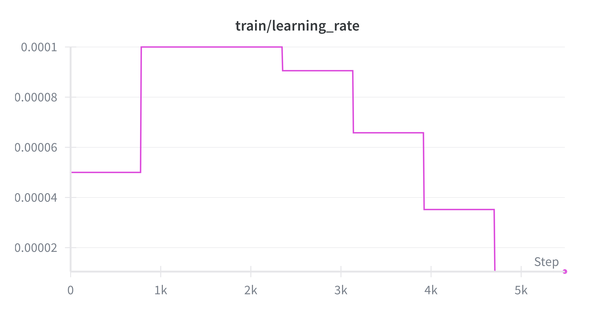

# Veridis Quo
**Where is the truth?** At a time when video is gradually ceasing to be viable evidence, with the constant progress of tools for manipulating this media, we feel the need to seek new ways of discerning reality from fake. 
Veridis Quo is a neural network designed to **detect deepfake videos** and **highlight the altered areas** in each frame.

TODO...

## Param
```bash
Total params: 40,798,098
Trainable params: 40,798,098
Non-trainable params: 0
----------------------------------------------------------------
Input size (MB): 0.57
Forward/backward pass size (MB): 300.57
Params size (MB): 155.63
Estimated Total Size (MB): 456.78
```

## Prerequisites

Install [uv](https://docs.astral.sh/uv/):
```bash
curl -LsSf https://astral.sh/uv/install.sh | sh
# OR
pip install uv
```

## Launch

```bash
./scripts/dev.sh
# OR
uv sync
uv run python src/main.py
```

## Tests

```bash
./scripts/run_tests.sh
# OR
uv sync --extra dev
uv run pytest tests/ -v
```


## Training

<table>
<tr>
<td width="60%" valign="top">

### Infrastructure

Nous avons entraîné le modèle sur une **RTX 3090** (avec CUDA) pendant environ **4 heures**.

Nous avons utilisé le provider de GPU [vast.ai](https://vast.ai/)

Le fichier d'entraînement se situe dans le module `training/trainer.py`

</td>
<td width="40%" align="center">

```
┌─────────────────────┐
│   NVIDIA RTX 3090   │
│        CUDA         │
│     ~4h training    │
└─────────────────────┘
```

</td>
</tr>
</table>

---

## Dataset

<table>
<tr>
<td width="50%" valign="top">

### Source

Nous sommes partis du dataset existant trouvé sur Kaggle :  
**[FaceForensics++ Dataset (C23)](https://www.kaggle.com/datasets/xdxd003/ff-c23)**

Contenant **7000 vidéos** avec de nombreuses techniques de deepfake :

<p>
  
  
  
  
</p>

Nous avons extrait les frames et les visages de ces vidéos pour créer notre dataset :  
**[VeridisQuo Dataset](https://www.kaggle.com/datasets/gazeux330000/deepfake-dataset/settings)**

</td>
<td width="50%" valign="top">

### Distribution

| Split | Samples | Ratio |
|:-----:|--------:|:-----:|
| **Train** | 499 965 | 70% |
| **Test** | 107 620 | 15% |
| **Eval** | 108 853 | 15% |

<p align="center"><strong>Total : 716 438 samples</strong></p>

</td>
</tr>
</table>

---

## Configuration & Résultats

<table>
<tr>
<td width="30%" valign="top">

### Configuration

| Paramètre | Valeur |
|:----------|:------:|
| `batch_size` | 64 |
| `learning_rate` | 0.0001 |
| `min_learning_rate` | 0.000001 |
| `num_epochs` | 7 |
| `weight_decay` | 0.0001 |
| `optimizer` | AdamW |
| `scheduler` | Warmup + Cosine Annealing |
| `warmup_epochs` | 2 |
| `use_automixed_precision` | false |
| `loss_func` | *(à préciser)* |

<br>

<p align="center">
  <a href="https://huggingface.co/Gazeux33/VeridisQuo/tree/main">
    
  </a>
</p>

</td>
<td width="70%" valign="top">

### Résultats

<table>
<tr>
<td align="center">

**Training Accuracy**


</td>
<td align="center">

**Training Loss**


</td>
</tr>
<tr>
<td align="center">

**Validation Accuracy**


</td>
<td align="center">

**Validation Loss**


</td>
</tr>
<tr>
<td colspan="2" align="center">

**Learning Rate Schedule**



</td>
</tr>
</table>

</td>
</tr>
</table>


## Project Structure
```
veridisquo/
├── scripts/                   # Helper scripts
│   ├── dev.sh                 # Development environment setup script
│   └── run_tests.sh           # Unit tests execution script
├── src/                       # Source code
│   ├── preprocessing/         # Data preprocessing module
│   ├── spatial/               # Spatial feature extraction module
│   ├── data/                  # Dataset loaders module
│   ├── frequal/               # Frequency feature extraction module
│   └── main.py                # Main script
├── tests/                     # Unit tests
│   ├── preprocessing/         # Tests for data preprocessing
│   ├── spatial/               # Tests for spatial feature extraction
│   └── frequal/               # Tests for frequency feature extraction
├── README.md                  # Project documentation
└── pyproject.toml             # Project configuration
```

### Frequency Analysis Module Structure
```
  BaseFrequencyExtractor (ABC)
  │   ├── extract() [template method]
  │   ├── _preprocess_image() [abstract]
  │   ├── _apply_transform() [abstract]
  │   └── _extract_features() [abstract]
  ├── BaseFFTExtractor(BaseFrequencyExtractor) (ABC)
  │   │   ├── Constantes FFT
  │   │   ├── _apply_transform() → call _apply_fft()
  │   │   ├── _extract_features() → call _extract_frequency_features()
  │   │   ├── _apply_fft() [abstract]
  │   │   └── _extract_frequency_features() [abstract]
  │   ├── NpFFTExtractor(BaseFFTExtractor)
  │   │   └── NumPy implementations
  │   └── TorchFFTExtractor(nn.Module, BaseFFTExtractor)
  │       └── PyTorch implementations
  └── BaseDCTExtractor(BaseFrequencyExtractor) (ABC)
      │   ├── Constantes DCT (AVAILABLE_AGGREGATION_METHODS, DEFAULT_BLOCK_SIZE, etc.)
      │   ├── _apply_transform() → call _extract_dct_blocks()
      │   ├── _extract_features() → call _aggregate_block_features()
      │   ├── _extract_dct_blocks() [abstract]
      │   └── _aggregate_block_features() [abstract]
      ├── NpDCTExtractor(BaseDCTExtractor)
      │   └── NumPy implementations + 3 aggregation methods
      └── TorchDCTExtractor(BaseDCTExtractor)
          └── PyTorch implementations
```