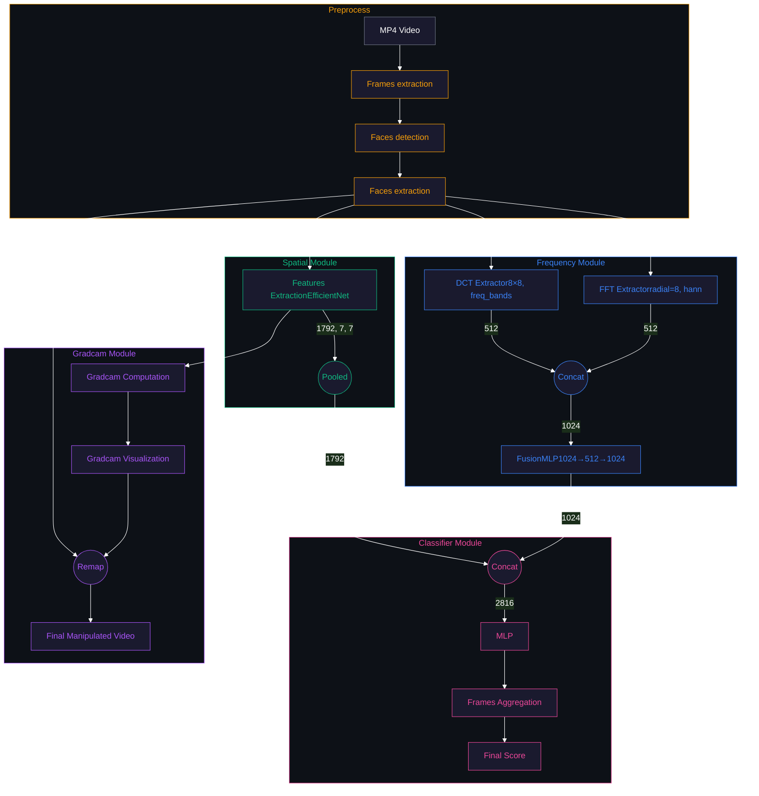
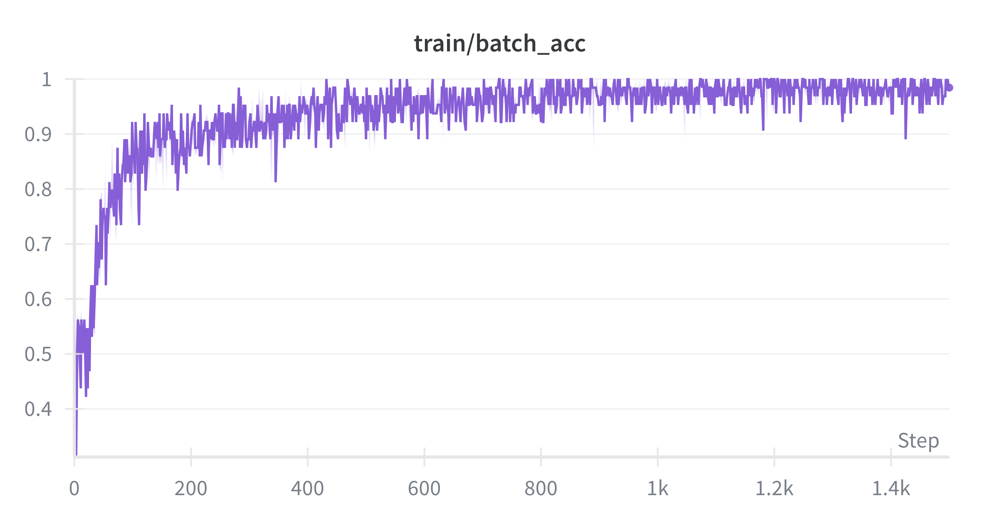
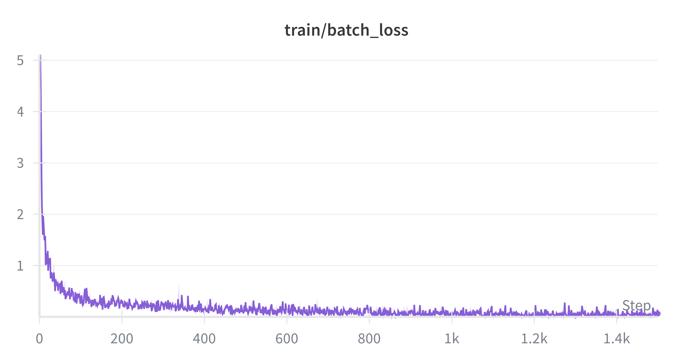
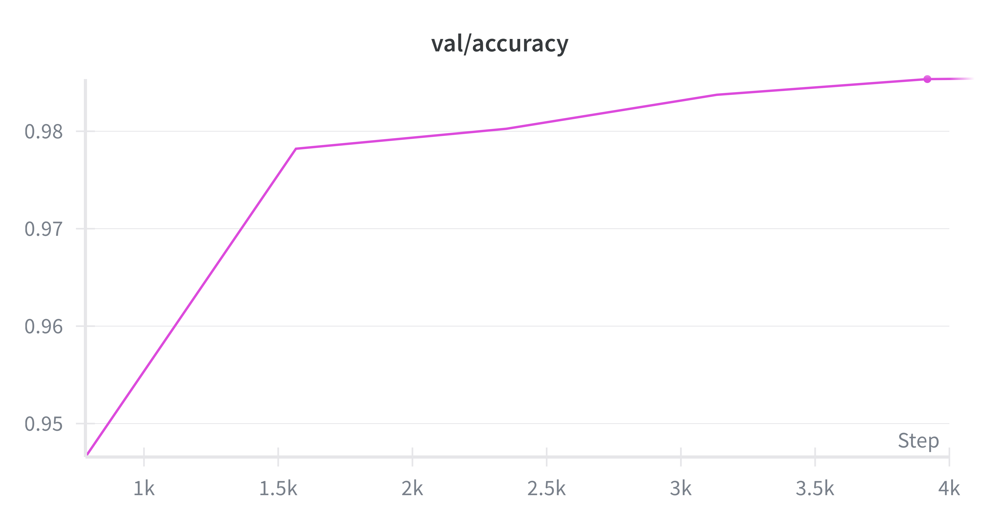
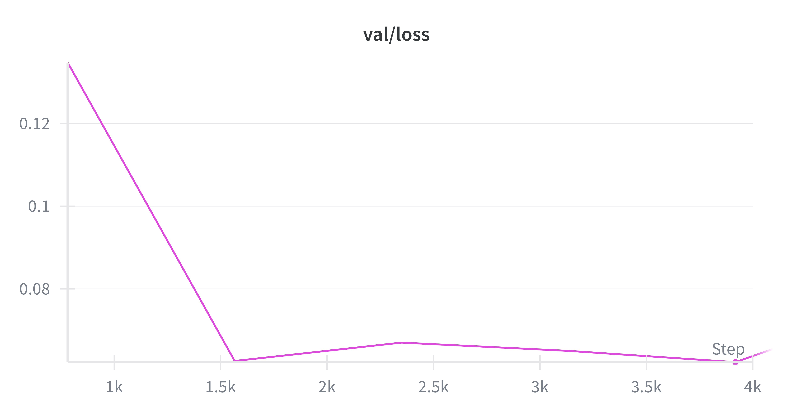

# Veridis Quo

<table>
<tr>
<td width="60%" >
    
### *Where is the truth?*
    
#### **What is Veridis Quo?**

A state-of-the-art neural network designed to **detect deepfake videos** and **highlight the altered areas** in each frame using explainable AI.

---

#### **How does it work?**

VeridisQuo uses a **hybrid architecture** combining spatial and frequency-domain analysis. **EfficientNet-B4** extracts spatial features from faces, while **frequency analysis** captures artifacts invisible to the human eye. These streams merge into a unified classifier, achieving robust detection across multiple deepfake techniques.


</td>
<td width="40%" valign="middle" align="center">


</td>
</tr>
</table>


# Pipeline



---


## Training
<table>
<tr>
<td width="60%" valign="top">

### Infrastructure
We trained the model on an **RTX 3090** (with CUDA) for approximately **4 hours**.
We used the GPU provider <a href="https://vast.ai/" target="_blank">vast.ai</a>

The training file is located in the `training/trainer.py` module

</td>
<td width="40%" valign="middle">

| Specs | |
|:---------|:---|
| **GPU** |  |
| **Framework** |  |
| **Duration** |  |

</td>
</tr>
</table>

---

## Dataset
<table>
<tr>
<td width="50%" valign="top">

### Source
We started from an existing dataset found on Kaggle:  
**<a href="https://www.kaggle.com/datasets/xdxd003/ff-c23" target="_blank">FaceForensics++ Dataset (C23)</a>**

Containing **7000 videos** with numerous deepfake techniques:
<p>
  
  
  
  
</p>

We extracted the frames and faces from these videos to create our dataset:  
**<a href="https://www.kaggle.com/datasets/gazeux330000/deepfake-dataset/settings" target="_blank">VeridisQuo Preprocessed Dataset</a>**

</td>
<td width="50%" valign="top">

### Distribution
| Split | Samples | Ratio |
|:-----:|--------:|:-----:|
| **Train** | 499,965 | 70% |
| **Test** | 107,620 | 15% |
| **Eval** | 108,853 | 15% |

<p><strong>Total: 716,438 images</strong></p>

</td>
</tr>
</table>

---

## Configuration & Results
<table>
<tr>
<td width="30%" valign="top">

### Configuration
| Parameter | Value |
|:----------|:------:|
| `batch_size` | 64 |
| `learning_rate` | 0.0001 |
| `min_learning_rate` | 0.000001 |
| `num_epochs` | 7 |
| `weight_decay` | 0.0001 |
| `optimizer` | AdamW |
| `scheduler` | Warmup + Cosine Annealing |
| `warmup_epochs` | 2 |
| `use_automixed_precision` | false |
| `loss_func` | *(to be specified)* |

<br>
<p align="center">
  <a href="https://huggingface.co/Gazeux33/VeridisQuo/tree/main" target="_blank">
    
  </a>
</p>

</td>
<td width="70%" valign="top">

### Results

**Training Accuracy**
<br>


**Training Loss**
<br>


<!--**Validation Accuracy**
<br>


**Validation Loss**
<br>
-->

</td>
</tr>
</table>


## Launch

### API Service

```bash
chmod +x ./scripts/launch_api.sh
./scripts/launch_api.sh
```

**FastAPI server** running on `http://localhost:8000`

| Endpoint | Description |
|:---------|:------------|
| `/docs` | Interactive API documentation (Swagger) |
| `/api/v1/health` | Health check and model status |
| `/api/v1/analyze` | Video deepfake detection endpoint |

**Custom launch options**:
```bash
uv run python src/launch.py --port 8080 --reload --debug
```

### Frontend Service

```bash
chmod +x ./scripts/launch_frontend.sh
./scripts/launch_frontend.sh
```

**React + Vite** development server on `http://localhost:3000`

API requests automatically proxied to backend via Vite ([vite.config.ts:10](frontend/vite.config.ts#L10))


